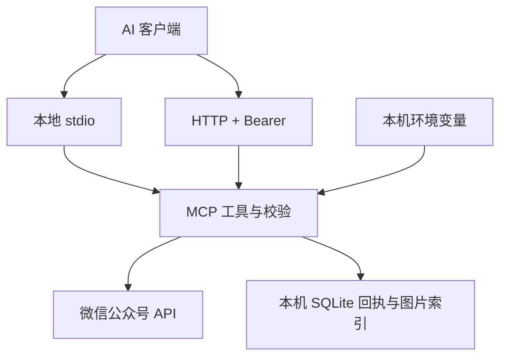

# 公众号草稿助手 · WeChat Draft Assistant

让支持 MCP 的 AI 客户端读取、创建、修改微信公众号草稿，并上传封面与正文图片。

**每个人部署自己的实例，配置自己的公众号。** 本目录是可移植的自部署版本，使用 Node.js 24 和 SQLite，不依赖原作者的服务器、账号或 ChatGPT Sites 环境，也没有内置凭据。代码采用 [MIT 许可证](LICENSE)，可以使用、修改和再分发。

当前版本提供 **stdio** 和 **Bearer 认证的 Streamable HTTP（JSON 响应）**。普通 MCP 客户端可按下文配置；ChatGPT 网页端的接入限制见[兼容性](#兼容性与验证范围)。

## 快速开始：本地 stdio

需要 Node.js **24+**。运行时没有 npm 依赖，无须 `npm install`。

```bash
git clone https://github.com/ha2fde/agent-skills-lab.git
cd agent-skills-lab/plugins/wechat-draft-assistant
cp .env.example .env
```

用本机编辑器填写 `.env`：

```dotenv
WECHAT_APP_ID=你的公众号AppID
WECHAT_APP_SECRET=你的公众号AppSecret
WECHAT_DATA_DIR=./data
```

AppID/AppSecret 从你自己的微信公众号开发后台取得。在公众号的 **API IP 白名单**中添加运行机器的公网出口 IP。需要相应的草稿及素材接口权限；具体资格与额度以账号后台显示为准。动态家庭宽带可能需要更新白名单，长期使用可部署到有固定公网出口的服务器。不要用 `0.0.0.0/0` 代替白名单配置。

```bash
node src/server.mjs --help
npm test
npm start
```

`npm start` 等待 MCP 客户端从标准输入发送 JSON-RPC，直接在终端启动后没有输出是正常的。客户端应直接执行 `node`，避免 npm 的启动提示干扰 stdio。

将 [examples/mcp-stdio.json](examples/mcp-stdio.json) 合入客户端 MCP 配置，把所有 `/ABS/...` 改成实际**绝对路径**。其中 `.env` 由 Node 读取，密钥不需要写入客户端 JSON；`WECHAT_DATA_DIR` 使用绝对路径，避免客户端工作目录变化导致回执位置变化。Windows 可在 JSON 中使用 `C:/...` 路径。

Codex 用户可参考 [examples/codex-stdio.toml](examples/codex-stdio.toml)。WorkBuddy 等客户端只要支持本地 stdio MCP，也可以按其 MCP 配置格式填写 `command`、`args` 和 `env`；本项目没有在这些客户端逐一实测。

接好后先让客户端调用 `wechat_connection_status`，再调用 `wechat_check_connection`。后者实际读取微信草稿数量；它不代表已经写入文章。

## 能做什么

| 工具 | 用途 |
|---|---|
| `wechat_connection_status` | 检查环境是否配置，不返回密钥或账号标识 |
| `wechat_check_connection` | 实际读取草稿数量，检查权限和网络 |
| `wechat_list_drafts` | 分页查询草稿，最多 20 条/页 |
| `wechat_get_draft` | 读取完整文章及 `content_hash` |
| `wechat_list_images` | 查询本实例上传到当前公众号的最近 30 张图片 |
| `wechat_upload_image` | 上传封面或正文 JPEG/PNG |
| `wechat_create_draft` | 创建 1–8 篇文章组成的草稿，写后读回 |
| `wechat_update_draft` | 检查旧内容指纹后修改指定文章，写后读回 |

工具范围到**草稿箱**为止。正式发表、群发和删除接口不在本项目中。内容生成由你的 AI 客户端完成，本服务只负责调用公众号接口。

## 架构与数据边界



- **MCP 层**：工具定义、JSON-RPC、输入大小限制、错误封装；单次工具错误不终止整个 stdio 进程。
- **微信层**：固定调用 `api.weixin.qq.com`；AppSecret、微信 access token 不进入工具结果；access token 仅在内存缓存，不自动重放写请求。
- **回执层**：SQLite 保存请求编号、处理状态和成功结果；确认写入前先记录请求。重启后仍拦截重复写入。
- **图片层**：本地目录、少量 Base64、受限的 ChatGPT 文件下载地址三选一；下载与微信请求都拒绝跳转到其他地址。

自部署版将托管版的平台登录、私有设置页面和云数据库，替换为本机环境配置、stdio/HTTP 认证和本机 SQLite。保留八个草稿工具及写入保护逻辑。部署者需要自行维护运行环境；本仓库不提供共享的多用户后台。

## 图片上传

推荐把图片放进专用目录，在 `.env` 中设置绝对路径：

```dotenv
WECHAT_IMAGE_ROOT=/ABS/wechat-images
```

该目录默认不启用，启用后只允许读取目录内的相对路径，不允许 `..`、绝对路径或指向目录外的符号链接。目录应只由部署者管理，不要设为用户主目录或共享的不可信写入目录。

```json
{
  "filename": "cover.jpg",
  "purpose": "cover",
  "image_path": "cover.jpg"
}
```

`purpose=cover` 返回永久素材 `media_id`，用于文章的 `thumb_media_id`；`purpose=body` 返回图片 URL，用于正文 ``。

本项目的文件大小上限为封面 **10 MiB**、正文图片 **1 MiB**；微信可能按账号、素材类型和图片格式施加额外限制，以实际接口结果为准。对话参数中的 `image_base64` 仅接受原图不超过 **128 KiB** 的小图，避免把数百万字符塞进工具调用。也可传 `image_url`，但只接受代码列出的 ChatGPT 图片文件 HTTPS 下载域名，其他图片优先使用本地文件。

Docker 方式使用本地图片时，在 Compose 中给 `/app/images` 添加自己的只读挂载，并设置 `WECHAT_IMAGE_ROOT=/app/images`；示例默认没有挂载宿主机文件。

## 创建、修改和重试

1. 检测连接，准备静态 HTML；先上传图片，取得真实封面素材 ID 和正文图片 URL。
2. 创建时生成唯一的 `request_id`，传入 `articles`。新操作用新编号；重试同一操作保持编号和内容完全一致。
3. 返回 `created=true` 或 `updated=true` 表示微信已确认写入；`readback_verified=true` 表示随后成功读回该 ID 的草稿。读回内容由微信返回，不等于逐字比较排版。
4. 写入成功但读回失败时，结果仍保留 `media_id` 和成功标记。查询这个 ID，不能重新创建。
5. 超时、断网或进程意外退出可能留下 `processing/unknown` 回执。同一编号不会再次写入。先查草稿箱核实，不能通过换编号绕过保护。
6. 修改前用 `wechat_get_draft` 取得文章最新 `content_hash`，传给 `expected_content_hash`。旧内容变化时拒绝覆盖。

回执只为创建与修改提供重复提交保护。图片上传没有请求编号，上传超时后也应先检查素材，避免重复上传。更新前的指纹检查不是微信服务端的原子条件更新；公众号后台或另一个部署实例仍可能在检查后修改文章，建议同一草稿顺序编辑。

正文使用静态 HTML 和内联 CSS。工具会做脚本、表单和图片来源的基本检查；这不是通用 HTML 清洗库。写入后仍需在微信手机预览中检查图片、代码换行和版式。

## HTTP 与 Docker

HTTP 模式默认只监听 `127.0.0.1:8787`，所有 `/mcp` 请求都要求 Bearer token。生成随机 token 后保存在本机 `.env` 的 `MCP_BEARER_TOKEN` 中：

```bash
node -e "console.log(require('node:crypto').randomBytes(32).toString('hex'))"
npm run start:http
```

客户端地址为 `http://127.0.0.1:8787/mcp`。Codex 的 Bearer 配置见 [examples/codex-http.toml](examples/codex-http.toml)，客户端的环境变量应与服务端 token 一致。不要把 token 写进 URL。

有 Docker Compose 的机器也可运行：

```bash
docker compose up -d --build
docker compose logs --tail=30
docker compose stop
```

Compose 通过本机回环地址暴露端口，容器以非 root 用户运行，数据库放在命名卷中。停止或重建容器会保留回执；`docker compose down -v` 会删除卷，**不要在存在未核实写入时删除回执**。

需要给其他机器连接时，由部署者配置 HTTPS 反向代理、网络访问范围，并在 `MCP_ALLOWED_HOSTS` 中填写代理转发的实际 Host 值，例如 `mcp.your-domain.example`。Origin 默认全部拒绝，有浏览器调用需求时才填写明确的 `MCP_ALLOWED_ORIGINS`。本项目不信任 `oai-authenticated-user-id` 等任意客户端可伪造的身份头。

`GET /health` 只返回存活状态，不检测微信；`POST /mcp` 返回 JSON；`GET /mcp` 返回 405，不提供旧版 SSE 流。支持 MCP 协议版本 `2025-11-25`、`2025-06-18`、`2025-03-26`，请求上限为 512 KiB。

## 兼容性与验证范围

| 环境 | 当前状态 |
|---|---|
| Node.js 24 本地 stdio 进程 | 已验证初始化、工具列表、错误后继续调用 |
| 本机 HTTP + Bearer | 已验证认证、Host/Origin、通知、大小限制和模拟写入流程 |
| 微信草稿/图片操作 | 公开版通过模拟微信接口的行为测试；公开版未连接真实公众号复测 |
| Docker/Compose | 已提供部署文件；本次环境没有 Docker，未执行容器构建 |
| Codex / WorkBuddy / 其他 MCP 客户端 | 已给出配置示例；公开版未在各客户端逐一联调 |
| ChatGPT 网页端直接添加 | 本项目没有 OAuth 服务器；不能把静态 Bearer 当作网页端可配置的自定义 API key |

ChatGPT 网页端支持远程 MCP，但当前自定义服务器接入文档列出的认证方式是 OAuth、无认证及两者混合，不能替客户端配置任意 API key。若要把本版本直接接到网页端，需要另外接入合适的 MCP OAuth 网关，并确保身份与权限校验完整；这部分未在本项目中实现。不要为了连接网页端关闭 Bearer 认证。原托管版的平台登录机制也没有复制到本项目中。

本仓库公开源码供自行部署使用，不代表已经上架 OpenAI 官方插件目录，也不宣称是微信或 OpenAI 官方插件。

## 维护、费用与隐私

- **软件**：MIT 授权，不收取软件许可费。下载源码不需要申请作者的账号或服务。
- **账号**：使用者自己取得公众号开发凭据及接口权限；本项目不会注册账号、购买服务器或开通付费套餐。
- **运行**：可在已有电脑上运行，也可用自己的服务器。服务器、固定公网 IP、域名及带宽费用由各自选择的服务商决定，不承诺永久免费基础设施。
- **模型**：服务不调用 OpenAI 或其他模型 API，不需要额外模型 API key；AI 客户端自身的订阅或调用费用另计。
- **维护**：更新 Node.js/容器镜像和源码，维护白名单与凭据，备份回执数据库。SQLite 使用本机磁盘，不适合跨主机共享或直接放到网盘同步目录。
- **数据**：AppSecret 从环境读取，微信 token 只留在内存；SQLite 保存草稿操作结果和图片索引，可能含未发表正文，应保护数据目录及备份。密钥、数据库、图片和日志均不应提交到 Git。

## 常见错误

| 现象 | 处理 |
|---|---|
| 微信 `40164` | 核对真正调用微信的机器出口 IP，更新公众号白名单 |
| 微信 `48001` | 核对账号是否有对应草稿或素材接口权限 |
| 微信 `40007` | 检查封面素材是否属于当前公众号 |
| MCP HTTP `401` | 核对客户端与服务端 Bearer token，勿关闭认证 |
| MCP HTTP `403` | 核对 Host/Origin 配置与反向代理实际转发值 |
| `processing/unknown` | 先查询草稿箱核实；同一编号不会再次写入 |
| 草稿已变化 | 重新读取文章，确认内容后使用最新指纹 |
| stdio 没有输出 | 正在等待客户端消息；检查客户端是否直接启动 `node` |

## 开发验证

```bash
npm test
```

2026-11-06，在 Node.js 24.22.1 下运行 21 项行为测试全部通过，覆盖八个工具、重启后的回执、并发重复提交、丢失写入响应、读回失败、过期指纹、错误脱敏、图片下载与路径边界、真实 stdio 子进程以及 HTTP 认证与异常后续调用。测试不需要公众号凭据，也不会操作真实草稿。

源码入口：[src/server.mjs](src/server.mjs)；工具定义：[src/tools.mjs](src/tools.mjs)；微信 API：[src/wechat.mjs](src/wechat.mjs)；持久回执：[src/state.mjs](src/state.mjs)。

## 参考资料

[1] [MCP 2025-11-25：Transports](https://modelcontextprotocol.io/specification/2025-11-25/basic/transports)

[2] [OpenAI：Connect a custom MCP server](https://developers.openai.com/api/docs/guides/custom-mcp-server)

[3] [OpenAI：MCP authentication](https://developers.openai.com/plugins/build/auth)

[4] [ChatGPT / Codex：MCP 配置](https://learn.chatgpt.com/docs/extend/mcp)

[5] [微信公众号开发文档](https://developers.weixin.qq.com/doc/offiaccount/Getting_Started/Overview.html)

[6] [Node.js：SQLite](https://nodejs.org/api/sqlite.html)
